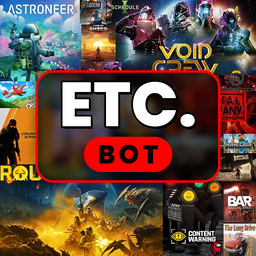

# ETC. Bot



Ein deutscher All-in-One-Bot für Discord-Server: Moderation, Server-Schutz (Lockdown, Linkschutz, Anti-Raid, Anti-Nuke),
temporäre Sprachkanäle mit Bedienfeld im Kanal-Chat, Musik und Soundboard, tägliche Quests, Level mit XP für Clips und Sprachzeit,
Münzen und Rollen-Shop, Tickets, Willkommen mit Bildkarte, Regeln akzeptieren, Gewinnspiele und ein **Web-Dashboard im Rot-Schwarz-StandBy-Look**.
Vorbilder waren Carl-bot und MEE6, aber alles ist kostenlos und gehört dir.

---

## Was der Bot kann

| Bereich | Funktionen |
|---|---|
| 🌐 **Web-Dashboard** | Login mit Discord, Server auswählen, **alles** einstellen: Schutz, Hubs für Temp-Kanäle, Level-Belohnungen, Shop, Auto-Antworten, Logs … Startseite mit Uhr und Kalender wie die iPhone-StandBy-Anzeige, großer Lockdown-Knopf. Jede Änderung speichert sofort. |
| 🔒 **Lockdown** | `/lockdown start` (oder Knopf im Dashboard) sperrt alle öffentlichen Kanäle (Text + Sprache), pausiert Einladungen, auf Wunsch auf Zeit. `/lockdown end` stellt **jede** Berechtigung exakt wieder her – auch nach einem Neustart. |
| 🔗 **Linkschutz** | GIFs (Tenor, Giphy, Klipy), hochgeladene Dateien, YouTube, Twitch, Discord-Links usw. funktionieren. Blockiert werden rund **39.000 bekannte Betrugs-Domains** (öffentliche Listen, alle 6 Std. aktualisiert), gefälschte Discord-/Steam-Seiten, IP-Logger, Kurz-Links, IP-Adressen, Punycode-Fälschungen. Modus **Smart** oder **Streng**. Optional Google Safe Browsing. |
| 🤖 **AutoMod** | Spam, fremde Einladungen, Massen-Erwähnungen, GROSSBUCHSTABEN, Wortfilter. Automatische Strafen ab 3/5/7 Verwarnungen. |
| 🚨 **Anti-Raid** / ☢️ **Anti-Nuke** | Beitrittswellen → automatischer Lockdown. Gehackte Admins oder fremde Bots, die Kanäle/Rollen löschen oder massenhaft bannen, werden sofort entmachtet; Gelöschtes wird wiederhergestellt. |
| 🔨 **Moderation** | `/ban` (auch auf Zeit), `/kick`, `/timeout`, `/warn`, `/purge` mit Filtern, `/modlogs`, Fall-Nummern, Logs. |
| 🔊 **Temp-Sprachkanäle** | Beliebig viele Hubs („➕ Kanal erstellen“, im Dashboard wählbar, je mit eigenem Namen/Limit/Kategorie). Im **Chat des neuen Sprachkanals** erscheint das Bedienfeld: Name, Limit, Sperren, Verstecken, Bitrate, Region, Erlauben, Rauswerfen, **Bannen/Entbannen**, Übernehmen, Übertragen, Zurücksetzen. Name, Limit und Bannliste werden pro Person gemerkt. |
| 🎵 **Musik** | `/play` mit YouTube-Link oder -Playlist, SoundCloud, Spotify-Song (wird auf YouTube gesucht), Radio-Stream, MP3-Link, eigene Datei oder einfach Songname. Warteschlange, Buttons (Pause, Skip, Stop, Wiederholen, Mischen, ±10 s, Lautstärke), `/filter` (Bass-Boost, Nightcore, Slowed + Reverb, 8D, Karaoke …), `/seek`, `/lyrics`. |
| 🔈 **Sounds** | `/sound play` spielt Discord-Soundboard-Sounds (Standard + eigene) im Sprachkanal, `/sound add` lädt eigene Sounds hoch. |
| 📺 **YouTube schauen** | `/watch` startet die Discord-Aktivität **Watch Together** im Sprachkanal: Alle schauen das YouTube-Video synchron. |
| 🗓️ **Tages-Quests** | Jeden Tag eigene Aufgaben pro Person (Nachrichten, Sprachzeit, Clips posten, 🔥 sammeln, Songs abspielen, Antworten, Reaktionen …). Belohnung XP + Münzen, Bonus für alle geschafft, **Serie** (Streak). `/quests` |
| ⭐ **Level & Clips** | XP für Nachrichten, **Zeit im Sprachkanal** und **Clips** im Clip-Kanal (Videos, Medal, Twitch-Clips, Shorts …). 🔥-Likes geben dem Ersteller XP, die besten Clips landen in der **Hall of Fame**. Rang-Bildkarte, Bestenliste (XP, Münzen, Sprachzeit, Clips), Rollen-Belohnungen. |
| 🪙 **Münzen** | `/daily` mit Serie, `/balance`, `/pay`, **Rollen-Shop** (`/shop`). |
| 👋 **Willkommen & Regeln** | Willkommen mit Bildkarte, Abschied, Auto-Rollen, Regeln mit „Akzeptieren“-Button + Captcha. |
| 🎫 **Tickets** | Button → privater Kanal, Übernehmen, Schließen mit Protokoll-Datei. |
| 🎉 **Extras** | Gewinnspiele, Umfragen, Vorschläge mit Abstimmung (`/suggest`), Erinnerungen (`/remind`), Auto-Antworten, Statistik-Kanäle (Mitgliederzahl), Embed-Baukasten, Rollen per Button. |

---

## Ehrlich: Was nicht geht

- **YouTube-Video als 4K-Stream (Go Live / Bildschirm übertragen):** Discord erlaubt Video-Streams **nur echten Nutzer-Accounts**, nicht Bots. Die Umwege laufen über sogenannte „Self-Bots“, also einen echten Nutzer-Account, der wie ein Bot gesteuert wird. Das verstößt gegen die Discord-Regeln und führt zur Sperre des Accounts, deshalb ist das hier nicht eingebaut. 4K würde außerdem Nitro und viel mehr Rechenleistung brauchen, als Gratis-Server haben. **Stattdessen:** `/watch` (Watch Together, Bild direkt von YouTube) plus `/play` für den Ton.
- **YouTube blockiert manchmal Server-Adressen** („Bist du ein Bot?“). Dann helfen `YTDLP_COOKIES` (siehe unten) oder andere Quellen (SoundCloud, MP3-Links, Radio). Hinweis: YouTubes Nutzungsbedingungen erlauben das Abspielen über Bots eigentlich nicht – das Risiko trägt der Betreiber.
- **Render (gratis)** hat sehr wenig Rechenleistung (0,1 CPU). Musik kann dort ruckeln. Für Musik ist **Oracle Cloud Always Free** deutlich besser (siehe unten).
- **Anti-Nuke** kann gelöschte Kanäle und Rollen neu anlegen, aber keine alten Nachrichten und keine Rollen-Zuweisungen zurückholen.
- **iPhone als Server** geht nicht: iOS beendet Apps im Hintergrund. Einrichten und Bedienen geht aber komplett am iPhone.
- Discord erlaubt nur **2 Umbenennungen pro 10 Minuten** pro Kanal.

---

## Einrichtung (geht komplett am iPhone im Browser)

Du brauchst 4 kostenlose Konten: **Discord Developer Portal**, **GitHub** (hast du), **MongoDB Atlas**, **Render**. Dauer: etwa 25 Minuten.

### Schritt 1 – Bot bei Discord anlegen
1. Öffne <https://discord.com/developers/applications> → **New Application** → Namen eingeben.
2. Links **Bot**:
   - **Reset Token** → Token kopieren und sicher notieren (*wie ein Passwort – niemals teilen!*).
   - **SERVER MEMBERS INTENT** und **MESSAGE CONTENT INTENT** einschalten → **Save Changes**.
3. Links **OAuth2**:
   - **Client ID** kopieren.
   - **Client Secret** → **Reset Secret** → kopieren (für das Web-Dashboard).
   - Bei **Redirects** eintragen: `https://DEINE-ADRESSE.onrender.com/callback` (die Adresse bekommst du in Schritt 3 – danach hier nachtragen).
4. Bot einladen (ersetze `DEINE_CLIENT_ID`):
   `https://discord.com/oauth2/authorize?client_id=DEINE_CLIENT_ID&permissions=8&scope=bot%20applications.commands`

### Schritt 2 – Kostenlose Datenbank (MongoDB Atlas)
1. <https://www.mongodb.com/cloud/atlas/register> → Cluster **M0 (Free)**, Region Frankfurt.
2. **Database Access** → Benutzer mit Passwort anlegen.
3. **Network Access** → **Allow access from anywhere** (`0.0.0.0/0`).
4. **Connect** → **Drivers** → Link kopieren, `<db_password>` durch dein Passwort ersetzen.

### Schritt 3 – Bot online stellen (Render, kostenlos)
1. <https://render.com> → mit GitHub anmelden → **New +** → **Blueprint** → dieses Repository.
2. Render fragt nach:
   - `DISCORD_TOKEN` → Token aus Schritt 1
   - `MONGODB_URI` → Link aus Schritt 2
   - `DISCORD_CLIENT_SECRET` → Client Secret aus Schritt 1
3. **Apply**. Nach 2–4 Minuten steht im Log `Eingeloggt als …`.
4. Deine Adresse (z. B. `https://etc-bot-xxxx.onrender.com`) in Schritt 1 bei **Redirects** als `…/callback` eintragen.
5. Adresse öffnen → **Mit Discord anmelden** → Dashboard. 🎉

### Name und Profilbild
Beim **ersten Start** setzt der Bot das Icon aus `assets/icon/etc-bot-512.png` als Profilbild – aber nur, wenn noch keins da ist. Den Namen lässt er so, wie er im Developer Portal steht (nur mit `BOT_NAME` wird er geändert, mit `SKIP_BRANDING=1` passiert gar nichts).
Für die App-Seite im Developer Portal: **General Information → App Icon** → `assets/icon/etc-bot.png` hochladen.
Das Icon wird mit `python3 scripts/make-icon.py assets/icon/collage-original.webp assets/icon` aus der Spiele-Collage erzeugt.

### Schritt 4 – Wach halten
Render legt Gratis-Dienste schlafen, wenn 15 Minuten lang keine Anfrage von außen kommt. Der Bot ruft sich selbst alle 10 Minuten auf. **Zusätzlich empfohlen:** bei <https://cron-job.org> (kostenlos) alle 10 Minuten `https://DEINE-ADRESSE.onrender.com/health` aufrufen lassen.

### Schritt 5 – In Discord
1. **Server-Einstellungen → Rollen**: Bot-Rolle **ganz nach oben** ziehen.
2. `/setup quickstart` → Logs, Willkommen, Temp-Sprachkanäle, Tickets werden angelegt.
3. Im **Web-Dashboard** alles Weitere einstellen (Clip-Kanal, Quests, Musik, Shop, Regeln …) – oder per `/setup …`.
4. `/help` zeigt alle Befehle.

### Stabiler und besser für Musik: Oracle Cloud „Always Free“
Dauerhaft kostenlose Linux-VM, die nie schläft (Kreditkarte nur zur Identitätsprüfung):
```bash
sudo apt update && sudo apt install -y git curl
curl -fsSL https://deb.nodesource.com/setup_22.x | sudo -E bash - && sudo apt install -y nodejs
git clone https://github.com/DEIN-NAME/Discord-Bot.git && cd Discord-Bot
npm ci --omit=dev
cp .env.example .env && nano .env      # Werte eintragen; DASHBOARD_URL = http://DEINE-IP:3000
sudo npm i -g pm2 && pm2 start src/index.js --name discord-bot && pm2 save && pm2 startup
```

---

## Einstellungen (Umgebungsvariablen)

| Variable | Pflicht | Bedeutung |
|---|---|---|
| `DISCORD_TOKEN` | ja | Bot-Token |
| `MONGODB_URI` | bei Render ja | Datenbank; ohne wird in `./data` gespeichert |
| `DISCORD_CLIENT_SECRET` | für Dashboard | OAuth2-Secret für den Discord-Login |
| `DASHBOARD_URL` | nein | Öffentliche Adresse (bei Render automatisch) |
| `YTDLP_COOKIES` | nein | Falls YouTube blockiert: `cookies.txt` aus dem Browser (Erweiterung „Get cookies.txt“), **Base64-kodiert**. Am besten einen Zweit-Account nehmen. |
| `SAFE_BROWSING_KEY` | nein | Google Safe Browsing für unbekannte Links |
| `BRAND_COLOR` | nein | Embed-Farbe, Standard `fd0000` (StandBy-Rot) |
| `DEV_GUILD_ID` | nein | Befehle nur auf diesem Server registrieren |
| `KEEPALIVE_URL` | nein | Adresse für den Selbst-Ping (bei Render automatisch) |

## Für Entwickler

```bash
npm install
npm run check   # 35 Selbsttests ohne Discord: Befehle, Linkschutz, Lockdown, Temp-Voice, AutoMod,
                # Quests, Münzen, Clips, Dashboard-API und Eingabeprüfung, Audio-Kette (ffmpeg → Opus), Bildkarten
npm start
```

**Aufbau:** `src/index.js` (Start, Ereignisse, Zeitplaner) · `src/commands/` (62 Slash-Befehle) · `src/modules/` (Funktionen, `music/` für den Player) · `src/web/` (Dashboard: `server.js`, `schema.js` = erlaubte Einstellungen, `public/index.html` = Oberfläche) · `src/lib/` (Speicher, Linkfilter, Bildkarten) · `scripts/selftest.js`

Musik: yt-dlp wird beim ersten `/play` automatisch nach `./bin` geladen und wöchentlich erneuert; ffmpeg kommt aus `ffmpeg-static`.

Schriftart Poppins: SIL Open Font License (`assets/fonts/LIZENZ.txt`).
